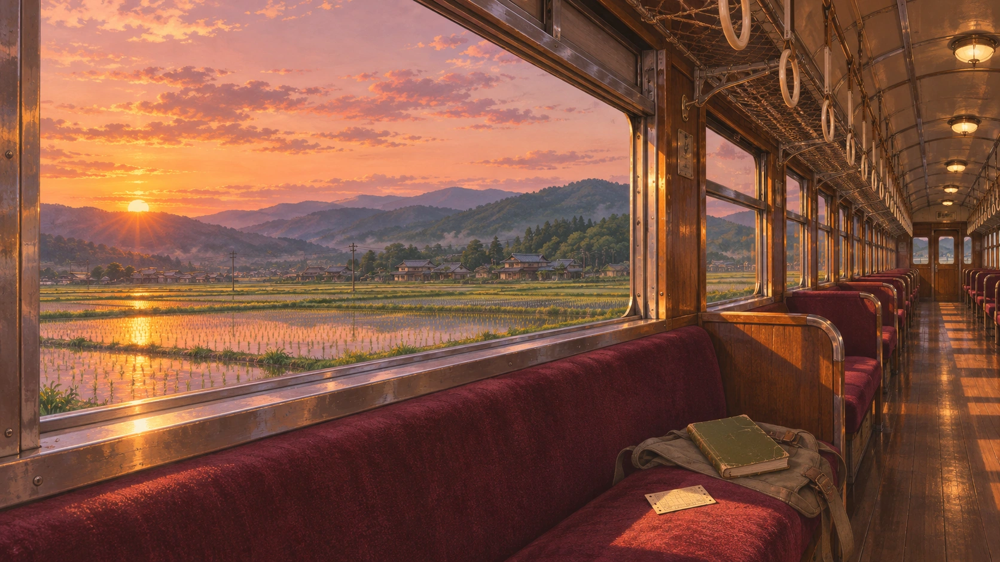
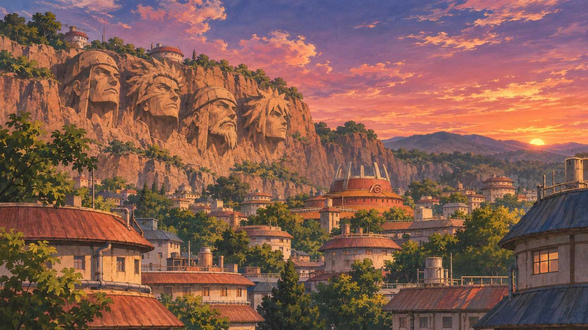
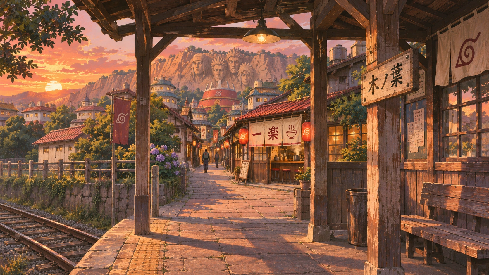
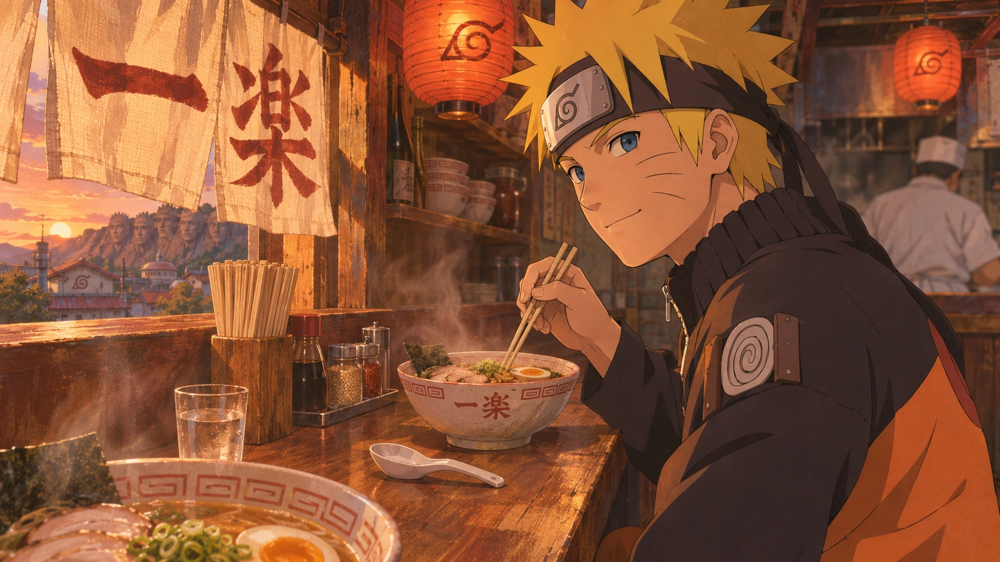

# The Train Beyond the Sea

A quiet ride through the anime you remember. Sit by the window, open your ticket book, travel to Konoha, step into Ichiraku, and write down the memory that brought you there.



**[Watch the 16-second journey preview](media/konoha-journey.mp4)** · **[Open the offline journey](dist/Window%20Seat.html)**

## The journey

The playable **Window Seat** experience begins in a sunset train carriage. The countryside moves beyond the windows, with rail sound and changing light. Open the ticket book and depart for Konoha. The train slows, reaches the platform, and leads you to an Ichiraku moment with Naruto. Your watch status, episode, and written memory are kept locally in your browser.

| On the way | At the stop |
| --- | --- |
|  |  |



## Start here

Download [`dist/Window Seat.html`](dist/Window%20Seat.html) and open it in a modern browser. It is a self-contained offline build with its artwork, sound, and scripts included. Click **Open ticket book**, then **Depart for Konoha**. The ride continues through the station to Ichiraku automatically; **Skip to Ichiraku** is available during the walk.

To work on the source, serve the repository locally and open `window-seat/`:

```sh
python3 -m http.server 8000
```

The original split files live in [`window-seat/`](window-seat/). Rebuild the standalone file with `node window-seat/build.mjs`.

## 3D carriage prototype

[`prototype-3d/`](prototype-3d/) contains an earlier free-roaming Three.js carriage experiment. You can sit, stand, walk the aisle, and open a door at Konoha. It is a prototype, separate from the finished guided Window Seat journey. Run it with `npm install` and `npm run dev` from that directory.

The older four-stop concept is also preserved at [`dist/The Train Beyond the Sea.html`](dist/The%20Train%20Beyond%20the%20Sea.html). The guided Konoha stop is the developed memory-lane scene; One Piece, Attack on Titan, and Jujutsu Kaisen are still concepts rather than finished stops.

## Art, sound, and fan tribute

The scene images are original generated illustrations used inside the experience. The preview video is a captioned visual tour of those illustrations, with train ambience; it is not a screen recording. Train sounds use CC0 field recordings credited in [`window-seat/credits.md`](window-seat/credits.md). This is an unofficial, non-commercial fan tribute and is not affiliated with the creators or rights holders of Naruto or the other referenced series.
